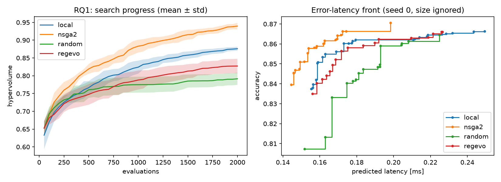
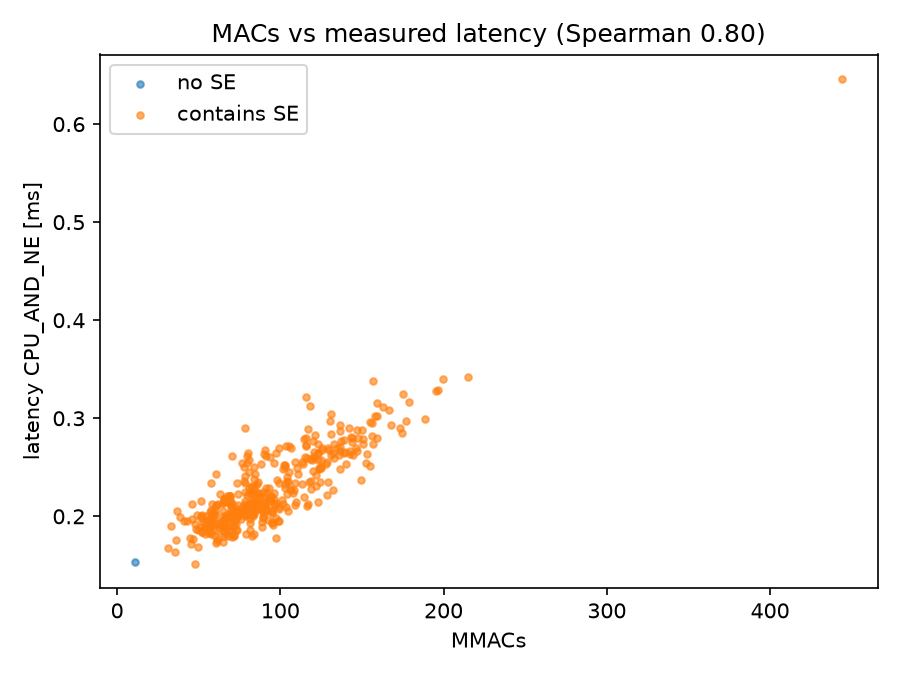

# I let evolution design neural networks for Apple's Neural Engine

Every recent iPhone and Mac has a chip built only for neural networks: the Apple Neural Engine (ANE).
It is fast. On my Mac, a small MobileNetV2 runs in 0.16 ms on the ANE, against 0.30 ms on the CPU and
0.66 ms on the GPU. But it is also picky. It handles some operations well and others badly, so the
usual rule of thumb, "less math means faster", only holds roughly.

For my semestral project in Computational Intelligence Methods (NIE-MVI, FIT CTU) I asked a simple
question: **can a genetic algorithm find out what this chip likes, just by trying networks on it?**

The answer is yes, with a few surprises along the way.

## Networks as genomes

Each candidate network is written down as a **genome of 91 integers**. The genes say:

- how large the input picture is (96, 112 or 128 pixels),
- how many blocks each of the six stages has and how wide it is,
- which filter size (3, 5 or 7) and expansion each block uses,
- whether a block gets a squeeze-excite add-on (a small "attention" module),
- how strongly each stage's weights are **compressed** (16, 8, 6 or 4 bits).

That last gene group matters. A phone app cares about download size too, so compression is part of
the design, not an afterthought.

Evolution then does its usual loop: start with random networks, score them, let the good ones have
children (mix their genomes, mutate a gene here and there), repeat. There are three scores at once:
**accuracy**, **latency on the Neural Engine** and **size in MB**. There is no single best network,
because a more accurate one is usually slower or bigger. So the algorithm I used, **NSGA-II**, keeps a
*Pareto front*: a menu of the best trade-offs, from "tiny and fast" to "most accurate".

An important rule from the course: **evolution only designs the architecture**. The weights are always
learned by ordinary gradient descent. Evolving millions of weights directly does not work.

## Making it affordable

Training each candidate from scratch takes 10–15 minutes on a GPU. A search needs thousands of
candidates, which would take months. Three tricks made it cheap:

1. **One network that contains all the others.** I trained a single *supernet* (82 minutes on a free
   Colab GPU) in which every candidate is a sub-network. To score a genome, I cut it out of the
   supernet, recalibrate its BatchNorm statistics, simulate the compression and test it. That takes
   about 4 seconds instead of 15 minutes.
2. **Real latency, measured once.** I converted 403 random networks to Core ML and timed them on the
   Mac's Neural Engine (about 2 seconds each).
3. **Two small predictors.** Small neural networks learn to predict accuracy and latency from the genome.
   After that, one evaluation takes microseconds, so I could run every experiment several times with
   different random seeds. In the end that was **over 120,000 evaluated networks**.

The GPU training ran on free Colab and Kaggle GPUs. Everything else ran on a 16 GB MacBook with an M4.

## What I found

### 1. Evolution beats the alternatives clearly

I gave four search methods the same budget of 2000 evaluations, five times each:

| Method | Hypervolume (higher = better front) |
|---|---|
| **NSGA-II** | **0.940** |
| Pareto local search | 0.876 |
| Regularized evolution | 0.827 |
| Random search | 0.791 |

Every NSGA-II run beat every run of every other method. Random search stops improving after about
500 networks: in a space of around 10^40 genomes, random samples almost never land at the extreme ends
of the front.

### 2. "Less math" is a decent guess for speed, but not the whole story

Counting multiply-accumulate operations (MACs) ranks real Neural Engine latency fairly well
(Spearman 0.80). The parameter count does badly (0.36): a network with few weights is not
automatically fast. One specific finding is that **squeeze-excite blocks cost more than their math
suggests**. With the same MACs and the same number of blocks, a network that uses squeeze-excite
everywhere is about 25 % slower than one that never uses it.

When I re-timed the evolved networks on the real chip, the search that used a learned latency predictor
gave the best fronts. Searching with MACs came close and searching with parameter count came last, but
with only three runs each the differences are not statistically significant.

### 3. Design and compress together

I compared three ways to get small networks:

- **jointly** evolving the architecture and the per-stage compression,
- evolving only the architecture and then compressing everything uniformly afterwards,
- not compressing at all.

The joint search won (hypervolume 0.914, against 0.888 and 0.850). It also found a pattern on its own:
**compress the late, wide stages hard and keep the early stages precise**. The average bit width falls
from about 11 bits in the first stage to 4.6 in the last.

### 4. The default settings were fine

I changed one setting at a time: population size, mutation rate, crossover type, and the repair step.
Most changes made no real difference. Two did: **uniform crossover clearly beats one-point crossover**,
and a population of 50 beats both 20 (which loses diversity and stalls) and 100 (too few generations
within the budget).

### 5. The shortcut is only roughly right

The supernet trick is only useful if its scores rank networks the way real training does. I trained 15
networks from scratch for 40 epochs and compared. The rank correlation is moderate (Kendall τ = 0.50,
p = 0.008). With 15 epochs it was only 0.11, because under-trained networks rank by how fast they learn,
not how well. The supernet also exaggerates the gaps: its scores spread over 14 percentage points, while
real training spreads the same networks over only 4. So I use it as a coarse filter, and the final
networks get retrained from scratch.

## What is still running

The final search (5000 evaluations, population 100) has just finished on the predictors. Its front is now
being re-checked with the supernet and real Neural Engine timings. Next, those networks get trained from
scratch and compared with MobileNetV2 at the same latency. I will also time them on an iPhone, to see
whether the speed ranking from the Mac's Neural Engine carries over to the phone.

## What I learned

- **A genetic algorithm is a good fit when the objectives are hard to write down.** Nobody has a formula
  for Neural Engine latency, but you can measure it, and evolution only needs a score.
- **Cheap, slightly wrong scores beat expensive, exact ones** for search. You just have to check how
  wrong they are, and re-check the winners properly.
- **Run every experiment with several seeds.** With one seed, half of the differences above would look
  like real effects.

*Code, notebook and the full technical report: [github.com/VagifAlyv/NeuralEvolve](https://github.com/VagifAlyv/NeuralEvolve).*
